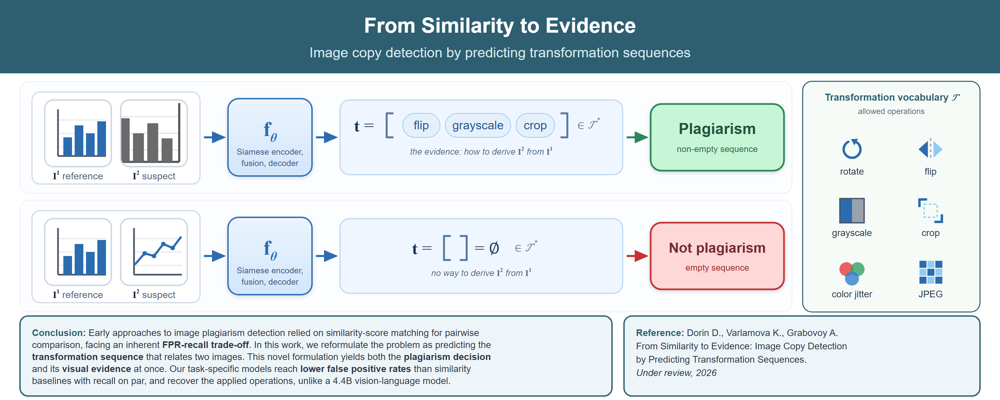

Image copy detection asks whether a suspect image is a transformed copy of a reference image, a critical question in academic publishing, media verification, and e-commerce. Existing methods rely on pairwise similarity scores, which offer little interpretability and confuse visual similarity with derivability. We reformulate the problem as *evidential copy detection*: the model predicts the sequence of operations from a fixed vocabulary that derives the suspect image from the reference image. An empty sequence means that no derivation exists. We propose an encoder-decoder model that recovers these sequences. We also introduce the Canonical Jaccard Index, a reconstruction metric that respects the algebraic structure of the dihedral group D₄ and scores non-geometric operations as an unordered set. On DomainNet and a curated multi-domain negative dataset, the models fine-tuned on hard negatives reach a lower false positive rate on content-similar negatives than similarity-based baselines. Their recall is comparable to that of these baselines and exceeds that of a widely used copy-detection descriptor on rotations, vertical flips, and composite sequences. A threshold sweep of that descriptor shows that no single similarity threshold gives both a low false positive rate and high recall. Our models need no threshold tuning. They also recover the applied operations, unlike a zero-shot vision-language model. The predicted sequence serves both as the decision and as a human-readable evidence trail that explains how the suspect image was obtained.

